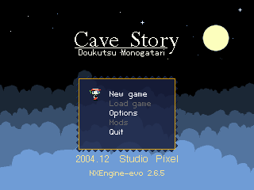
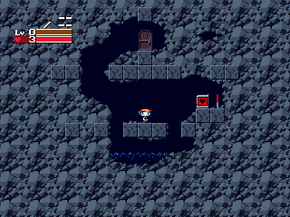
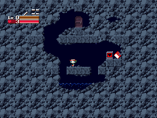

# NXEngine-evo (Cave Story) for AmigaOS 3.x / AmiCradle

NXEngine-evo is the open-source engine of Cave Story (Doukutsu Monogatari,
Studio Pixel, 2004): a rewrite of the game's engine that plays the original
freeware game's data. GPL-3.0 (upstream `LICENSE`). This repository holds
the AmiCradle port around upstream
[nxengine/nxengine-evo](https://github.com/nxengine/nxengine-evo) at
`1f093d1423cc395eb199230cd609b806ef1daa36` (2.6.5): 68040 + FPU, libnix,
SDL 2, SDL2_mixer and SDL2_image through GFOpenGPU, OpenAmigaGCC 16.2.0
(open3, open4 or GFOpenAmigaGCC open5). The port is MIT (`LICENSE`); the
upstream tree is not copied here: the build fetches the pinned commit.

Port Atlas: `g-nxengine-evo`.

## Building

The port never edits upstream: `build-amiga.sh` fetches the pinned commit
(`gameports/catalog.json`), takes a copy with `git archive`, applies
`patches/` with no fuzz and `patch_amigaos3_deps.py` (the bundled JSON and
spdlog headers on libnix), and compiles upstream's own source list (the
globs of its `CMakeLists.txt`, 131 sources) with the stove's compilers,
linking the stove's `libSDL2.a`, `libSDL2_mixer.a`, `libSDL2_image.a` and
`libGL.a` (GFOpenGPU's link stubs) and the locked libpng and zlib staged in
the stove (`toolchain/port-dependencies.lock.json`). spdlog and its bundled
fmt are compiled once, as spdlog's own compiled-library build does
(`amiga/spdlog_lib.cpp`, every other source with `SPDLOG_COMPILED_LIB`):
header-only, each source compiled the logger again, the build took over
nine minutes on Cradle and the program was 23.7 MB; now 90 seconds and
3.6 MB.

Through Cradle (the build the lab tests use): `stove_build` with the stove
`os32-gcc16`, target `.` for the program and target `runtime-data` for the
game data staged for a lab. From a checkout, with a staged stove:

```sh
STOVE=/path/to/os32-gcc16 OUT=build-amiga sh build-amiga.sh
STOVE=/path/to/os32-gcc16 OUT=build-amiga/data sh runtime-data/build-amiga.sh
```

`build-amiga.sh` takes OpenAmigaGCC 16.2.0-open3 (archive SHA-256
`9fcc136ab59e3bb5b91d2764d0bf290b709d72d7380be4ce0cdf005edf8eff21`),
16.2.0-open4 (`495319a2ffd803278f8827cad70074029c7aa9ecbe05d037e8646ba43ab94ab2`)
or GFOpenAmigaGCC 16.2.0-open5 (Cradle's `os32-gcc16` since the evening of
2 November 2026; no archive is published, so it is known by `STOVE.json`'s
release and the compiler's own `--version`, and its receipt records the
SHA-256 of the compiler's own programs) and refuses any other. Its
`receipt.json` names the compiler, the recipe's and patches' digests, the
SDK and codec inputs and the executable's SHA-256; the receipts of the
builds recorded here are in `receipts/`.

The older recipes are kept: `build-amigaos3.sh` (CMake, a staged open3
stove) and `build.sh` (AROS).

## Game data

The Cave Story data is not in this repository and not in the package. It
is the original freeware game's, from the address
`gameports/runtime-data.json` pins (SHA-256
`444c4265b5acc11495b8d5b00ef7e7843b5ee8e0f6a5d9c4201ed36adbd018f0`,
1,209,287 bytes; observed on 1 November 2026, not a publisher's digest),
laid out by `import_data.py` with the engine's own data from the pinned
commit:

```sh
python3 import_data.py \
  --archive /path/to/cavestory-nx-data.zip \
  --engine-data /path/to/nxengine-evo/data \
  --out build/nx-test-data
```

The importer makes a new directory and a digest receipt, flattens the old
`data/data` mirror layout, lays the pinned engine data over it, and adds the
original music names where size and CRC match upstream's extraction table.
It refuses unsafe or conflicting paths and never replaces an existing
output. `runtime-data/build-amiga.sh` does all of it on the build host
(fetching the pinned zip, checking its SHA-256 and size) and packs the
result as `nx-data.tar`, a plain ustar archive, with `untar`, a small Amiga
unpacker (`runtime-data/untar.c`, from amigapowermanga): that is how a lab
gets the data. It is staged there only, never committed or packaged.

## Running

`nxengine-evo` with no options opens a 320x240 screen of its own, the
game's own frame, unscaled (SDL's real full screen; it needs SDL2.module
from gfopenrtg main at `210df77` or later). Options, Graphics changes the
resolution and full screen (upstream's menu); the setting is saved. The
program reads `data/` beside itself (`PROGDIR:data`) and writes only in
`PROGDIR:User` (made on first start): `settings.dat`, the saves
(`profile.dat`), `debug.log` and F9's screenshots (`screenshotNNN.png`).
Controls are upstream's: the cursor keys move (Up looks up, Down
examines), Z jumps (and accepts), X fires (and goes back), A and S change
weapon, Q is the inventory, W the map, Escape the menu (Resume, Options,
Reset, Quit), F9 a screenshot; Options, Controls changes any of them. A
joystick or CD32 pad in port 2 is mapped by default on AmigaOS (upstream
maps none): the stick, d-pad or hat moves, red (A) jumps, blue (B) fires;
on a CD32 pad green and yellow are the map and the inventory, the
shoulders change weapon and Play is the menu. `SetEnv NX_INPUT
RAM:input.txt` logs every key, joystick and pad event the game takes.
`-fps` logs each second's rate of frames shown (`fps 49.9 at 14.057 s`)
and a summary at exit. The game runs its logic and draws at its own fixed
50 frames a second.

## Status

**FIRST LIGHT**, not RELEASE (see Observed below and the release gates in
amicradle `docs/porting/MEASUREMENT.md`).

| Gate | State |
|---|---|
| Pinned source, reproducible build, receipts | done (open5, Cradle) |
| Title and first room, the whole 320x240 frame on a screen of its own | done (49.7 frames a second, the game's rate is 50) |
| Keyboard play | done (menus, the opening, walking, jumping, the water) |
| Joystick / CD32 pad | not tested: no stick in the lab (SDL opens port 2 as a game controller) |

## Observed

### Build, 3 November 2026

Commit `f992e08`: clean compile and link of upstream at the pinned commit
with `patches/0001-aros-resource-manager.patch` and
`patch_amigaos3_deps.py`, no network code, by Cradle's `stove_build` with
the `os32-gcc16` stove (GFOpenAmigaGCC 16.2.0-open5, job
`j20261103T020914-854fa3`): 131 upstream sources and
`amiga/spdlog_lib.cpp` in 90 seconds; the 17 warnings are upstream's own
(unused variables, signed comparisons, `Pixtone.h`'s anonymous typedefs).

| Compiler | Executable SHA-256 | Bytes |
|---|---|---|
| 16.2.0-open5 (Cradle `stove_build`, job `j20261103T020914-854fa3`) | `dbd926a92a94f57d1508241de88b24e7596cf60be3c187acaf3e0e7498244a4a` | 3,613,692 |

The receipt is `receipts/1-build-open5-stove_build.json`. The game data
staged for the lab (job `j20261103T021128-d3f6dc`, `receipts/1-data.json`):
the pinned zip (SHA-256 checked) and the engine's data, 661 files with 26
music aliases, the import receipt `10c0ae7e...60e4` (the same as on
24 October), archive `15f6468d...b42e` (9,000,960 bytes), `untar`
`2de6090b...7b6d`. The same recipe
with spdlog header-only (commit `a7a8e65`, job `j20261103T015647-c343e7`)
also built, in 9 minutes 8 seconds, to a 23,753,916-byte program
(`1d279411...6d2e`); with two compiles at a time (commit `b84479f`, job
`j20261103T014028-36e125`) it ran past stove_build's 900 s, which is what
the catalogue's "deferred by host load" was.

### Presentation, 3 November 2026

Commit `f77fa71` adds `patches/0002-amiga-presentation.patch`: on AmigaOS
the game's own 320x240 frame on a screen of its own by default (upstream's
default is a 640x480 window), the settings, saves and log in
`PROGDIR:User` instead of `ENVARC:nxengine`, `-fps`, and F9's screenshot
on a big-endian machine (upstream asks SDL for 24 bits with 32-bit masks
there, which SDL refused: "Unknown pixel format"). Executable (open5,
Cradle job `j20261103T022206-4559fe`): SHA-256
`eef9c8b853276e218ac196c711a2cc744ff649bd14ad0f22fd13b4730016f214`
(3,617,972 bytes; `receipts/2-presentation-open5-stove_build.json`).

Run in `lab:nxengine`, a copy of Instance-32 (AC090 JIT, 68040 + FPU, RTG
1920x1080, AHI, muted), with SDL2.module built by Cradle from gfopenrtg main
at `77fb11f` (job `j20261103T015054-a27024`, SHA-256 `e923d22a...bb4d`,
1,002,284 bytes) in both `LIBS:OpenGPU/` and `LIBS:GFOpenGPU/` (the copy had
no `LIBS:GFOpenGPU/`; Instance-32's `SDL2_mixer.module` and
`SDL2_image.module` were copied there beside it); the game in
`Work:Games/NXEngine` with its data unpacked by `untar`; no `PROGDIR:User`
before the start; sound on.

- `nxengine-evo -fps`: the RTG head switched to 320x240 and the title
  filled it (log: `window 320x240, full screen, display mode 320x240`,
  `using: opengpu renderer`). The data, the 26 Organya songs and the sound
  effects loaded in about 7 seconds. Upstream's own warnings are there:
  37 of the `pxt` sound numbers upstream tries have no file in the
  freeware data (`fx08.pxt` to `fx63.pxt`), as on 24 October, and the Ogg music folders the
  options can choose are absent (`Music dir Ogg/ doesn't exist`); the
  original Organya music is what plays.
- New Game: the opening (the Shelter cut-scene, the dialogue) and the
  Start Point, Quote standing in the first cave with the status bar; F9
  wrote `PROGDIR:User/screenshot001.png`.
- **Frames shown: 49.7 a second on average** over 290 one-second readings
  (title, opening and Start Point), 44.5 at the lowest (four readings
  under 47: three at stage loads, one in the title's first seconds), 51.8
  at the highest. The game runs its
  logic and draws at a fixed 50 a second (`GAME_FPS`), so it keeps its own
  pace.
- Escape, Quit: a clean exit (`Script engine shutdown`, `Sound system
  shutdown`, `Renderer::Close()`), the Workbench came back.




The pictures are the screen as `Grab` read it (`tests/lab`: the front
screen through cybergraphics.library, written as PNG with a palette when
it has 256 colours or fewer); `tests/lab` also has HoldKeys, JoyPort and
Chop, as amigakobodeluxe has them.

### Controls, 3 November 2026

Commit `be4f213` adds `patches/0003-amiga-input.patch`: on AmigaOS a stick
or CD32 pad in port 2 (SDL joystick 0) is mapped by default, through the
stick's axes and the hat, so it works in GFOpenInput's layout and in
lowlevel.library's; a diagonal on the hat now moves both ways (upstream
takes one direction); the stick and the hat let go only of what they
held themselves (upstream clears every direction mapped to an axis each
frame, which with the default mapping left the cursor keys dead: the first
build of this step, `ecc1959`, showed it in the lab); what SDL sees is
logged; `SetEnv NX_INPUT RAM:input.txt` logs every key, joystick and pad
event (read with `SDL_getenv`: libnix's `getenv` did not see it in the
`ac0c68a` build). Executable (open5, Cradle job `j20261103T024016-c2e06d`):
SHA-256 `bf7480e4631c113e233eff51e0765ba9442a35520521ef660d828c39ebb24a2b`
(3,621,544 bytes; `receipts/3-input-open5-stove_build.json`).

In `lab:nxengine` as for the presentation, `SetEnv NX_INPUT
SYS:T/input.txt`, `nxengine-evo -fps`:

- What SDL sees (log): `Joysticks: 1`, `Joystick 0: "Amiga joystick port
  (2): joystick", a game controller`, opened with 6 axes, 21 buttons and 1
  hat (GFOpenInput's standard layout). `JoyPort` (`tests/lab`) reads
  lowlevel.library's port 1 (game port 2) as `none` and port 0 (the mouse
  port) as `unknown`.
- Keyboard: Z on New Game; `HoldKeys 28 CYCLE 31,32 PERIOD 15` (Z and X in
  turn) through the opening's dialogue to the Start Point; then the cursor
  keys held with `HoldKeys`: Quote walked right up onto the ledge by the
  door, jumped left (Left and Z held) and fell into the water at the foot
  of the cave (the air counter showed), and jumped out again; Escape,
  Quit. The input log has all 202 key presses and releases with their
  times (Z `122`, X `120`, Right `1073741903`, Left `1073741904`), and no
  joystick event.
- Frames shown: 49.5 a second on average over 108 readings, 41.9 at the
  lowest (a stage load), 51.8 at the highest.



Joystick and CD32 pad: not qualified. The lab has no stick (lowlevel
reports none in port 2); SDL finds and opens port 2 as a game controller,
and the mapping above is the default, but no stick or pad event was made.
A person with a stick or a CD32 pad has to try it.

### Earlier runs, 24 October 2026

The open3 build of 24 October (CMake, `build-amigaos3.sh`, executable
`3b3773b7...c866`) reached the title, the opening dialogue and the Start
Point room; it moved, jumped, saved and reloaded and quit with RC 0
([the run receipt](evidence/runtime-20261024.json)). Its saves went to
`ENVARC:nxengine`.
